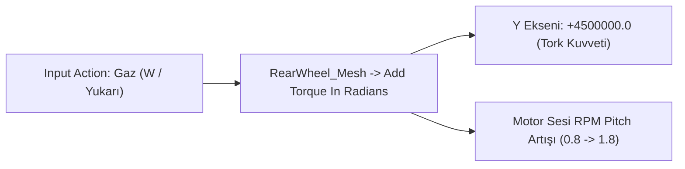
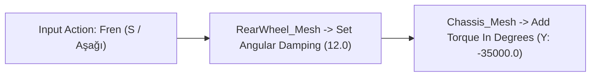

# 🏍️ Dağ Motorcusu: Moto Trial / Racer
## Unreal Engine 5 Fizik & Blueprint Mimari Rehberi

Bu belge, **Moto X3M**, **Trials HD** ve klasik **Moto Racer** dinamiklerine sahip, yön tuşlarıyla dengede durulan 2.5D dağ motosikleti oyununun **Unreal Engine 5** üzerindeki eksiksiz fizik ve Blueprint mimarisini içerir.

---

## 1. Fiziksel Motosiklet Kurulumu (`BP_TrialMotor`)

Arcade ve bağımlılık yapıcı bir trial oyununun sırrı, karmaşık araç tekerlek simülasyonları yerine **"Rigid Body + Physics Constraint"** (Kuvvet ve Süspansiyon Kısıtlayıcıları) mantığıdır.

### A. Bileşen Hiyerarşisi (Components)
```
BP_TrialMotor (Actor)
 └── Chassis_Mesh (Gövde - Static/Skeletal Mesh) [Simulate Physics = True, Mass = 150 kg]
      ├── FrontWheel_Constraint (PhysicsConstraint)
      │    └── FrontWheel_Mesh (Ön Tekerlek) [Simulate Physics = True, Mass = 22 kg]
      ├── RearWheel_Constraint (PhysicsConstraint)
      │    └── RearWheel_Mesh (Arka Tekerlek) [Simulate Physics = True, Mass = 22 kg]
      ├── Rider_Mesh (Sürücü) [Soket veya Fizik Kısıtlayıcı ile Gövdeye Bağlı]
      └── Head_Collision (Sphere Collision) [Kaza algılama kask alanı]
```

### B. 2.5D Düzlem Kilidi (Constraint to Plane)
Motosikletin sağa-sola devrilip kameradan uzaklaşmasını engellemek için:
* `Chassis_Mesh`, `FrontWheel_Mesh` ve `RearWheel_Mesh` seçin.
* **Physics** -> **Constraints** bölümünden:
  * **Lock Position:** `Y` ekseni = **Kilitli (True)**
  * **Lock Rotation:** `X` ve `Z` eksenleri = **Kilitli (True)**
  *(Böylece motor yalnızca X ekseninde ileri-geri, Z ekseninde yukarı-aşağı hareket eder ve Y ekseni etrafında takla/denge açısı alır).*

### C. Süspansiyon Ayarları (`PhysicsConstraint`)
* **Linear Limits:**
  * X, Y = `Locked`
  * Z = `Limited` (Limit: `15.0 cm`)
* **Linear Motor / Soft Constraint:**
  * `Soft Constraint` = **Checked**
  * `Stiffness (Yay Sertliği)` = **4200.0**
  * `Damping (Sönümleme)` = **450.0**
* **Angular Limits:**
  * Y ekseni (Tekerlek Dönüşü) = `Free`

---

## 2. Denge ve Gaz/Fren Blueprint Grafiği (Event Graph)

### A. Gaz (Accelerate / W / Yukarı Ok)


### B. Fren / Geri (Brake / S / Aşağı Ok)


### C. Havada ve Karada Denge Kontrolü (A-D / Sol-Sağ Ok)
Oyuncunun motosikleti düşmeden tepe üstünde tutmasını sağlayan açı torku:
* **Geriye Yaslan / Ön Kaldır (Sol Ok / A):**
  * `Chassis_Mesh -> Add Torque In Degrees` -> **Y = -75000.0**
  * Sürücü animasyonu: `Surucu_01_GeriYatis` karesine geç.
* **İleriye Yaslan / Burun Aşağı (Sağ Ok / D):**
  * `Chassis_Mesh -> Add Torque In Degrees` -> **Y = +75000.0**
  * Sürücü animasyonu: `Surucu_03_IleriYatis` karesine geç.

---

## 3. Takla & Havada Kalma Bonusu (360 Flip Detection)

1. `Event Tick` içinde motosikletin rotasyonunu (`GetActorRotation`) okuyun.
2. Bir önceki karenin `Pitch` açısı ile mevcut açı farkını `DeltaRotation` değişkenine ekleyin:
   * `KümülatifAçı += DeltaPitch`
3. Eğer `KümülatifAçı >= 360.0`:
   * `KümülatifAçı = 0`
   * `ShowBonusWidget("🔥 ÖN TAKLA BONUSU! +500")`
   * `PlaySound2D(A_TaklaKutlama)`
4. Eğer tekerlekler yere temas ederse (`OnComponentHit` veya `LineTrace` ile zemin kontrolü) kümülatif açıyı sıfırlayın.

---

## 4. Kaza ve Ragdoll Sistemi (`Head_Collision`)

Sürücünün başındaki `Head_Collision` bileşeninin `OnComponentBeginOverlap` olayında:
1. Çarpan aktör zemin ise (`Landscape` veya `BP_DagArazisi`):
2. `DisableInput` ile oyuncu kontrolünü kesin.
3. `Rider_Mesh` bileşenini gövdeden ayırın:
   * `DetachFromComponent`
   * `SetAllBodiesSimulatePhysics(True)` -> Sürücü fiziksel olarak yere savrulsun (Ragdoll efekti).
4. `PlaySound2D(A_KazaSesi)`
5. 1.5 saniye sonra `WBP_KazaEkrani`'nı ekrana getirin.

---

## 5. Hazır Varlıklar (Assets)

Projeniz için oluşturulan ve hemen Unreal Engine'e aktarabileceğiniz varlıklar:
* 📁 `UnrealEngine_Assets/Motosiklet_Govde.png`: 256x256 şasi görseli.
* 📁 `UnrealEngine_Assets/Motosiklet_Tekerlek.png`: 128x128 tırtıklı arazi lastiği ve jant.
* 📁 `UnrealEngine_Assets/Surucu_Animasyon/`: Denge hareketleri için 3 farklı sürücü eğilme karesi.
* 📁 `UnrealEngine_Assets/3D_Model/SK_DagMotoru_Rigged.glb`: Doğrudan UE5'e sürüklenebilen iskeletli ve tekerlek animasyonlu 3D motosiklet modeli.
